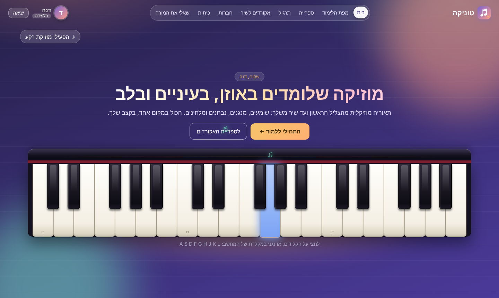
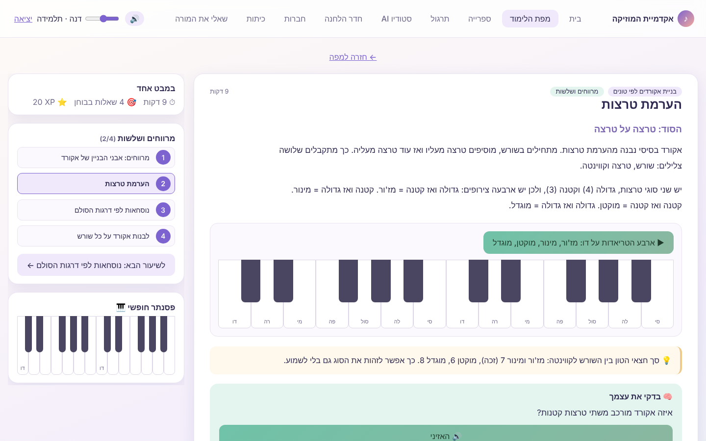
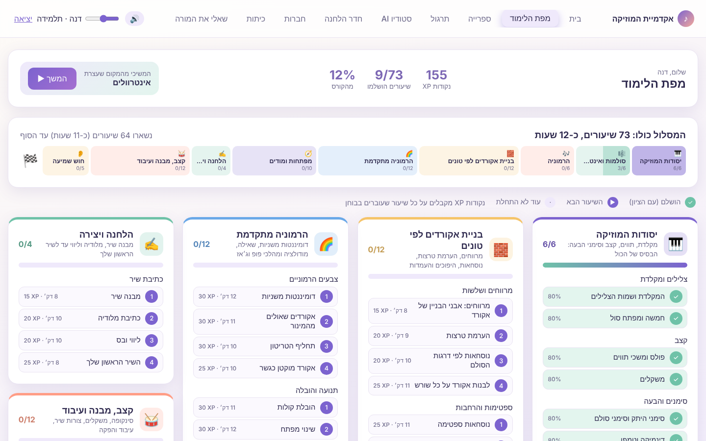
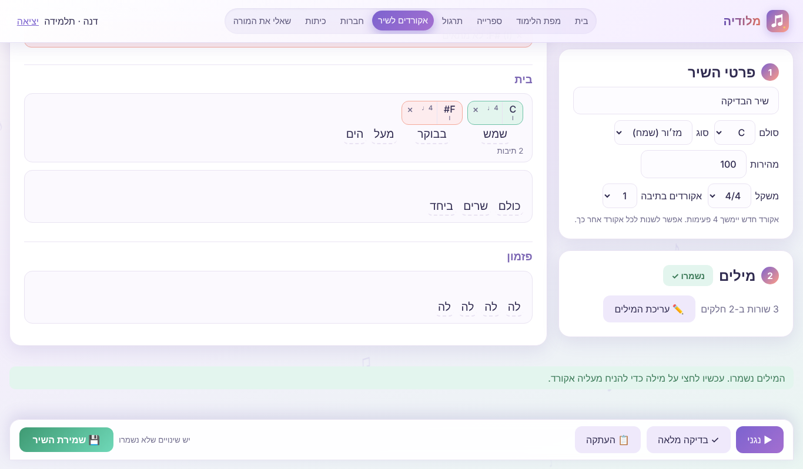
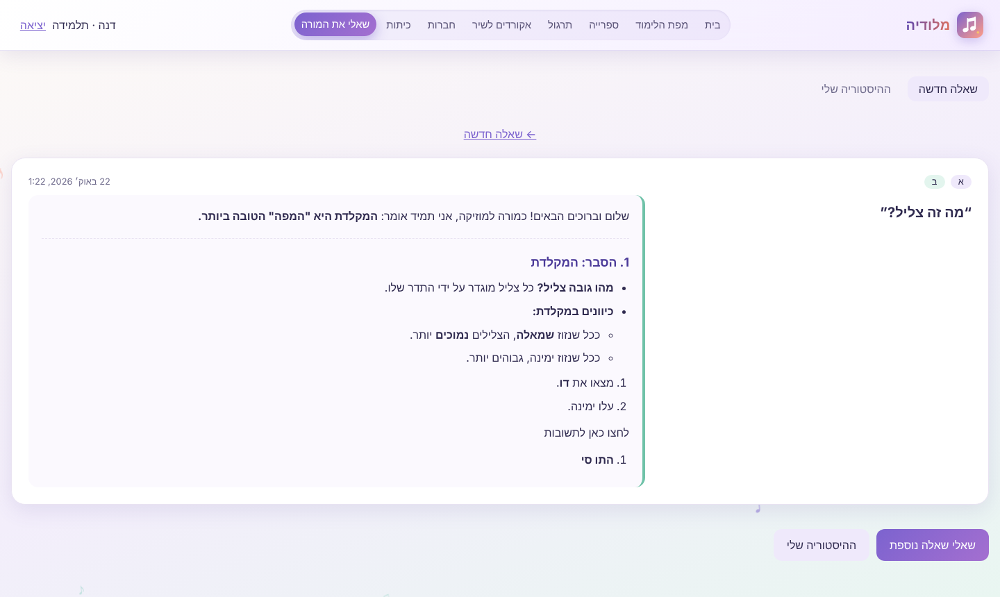
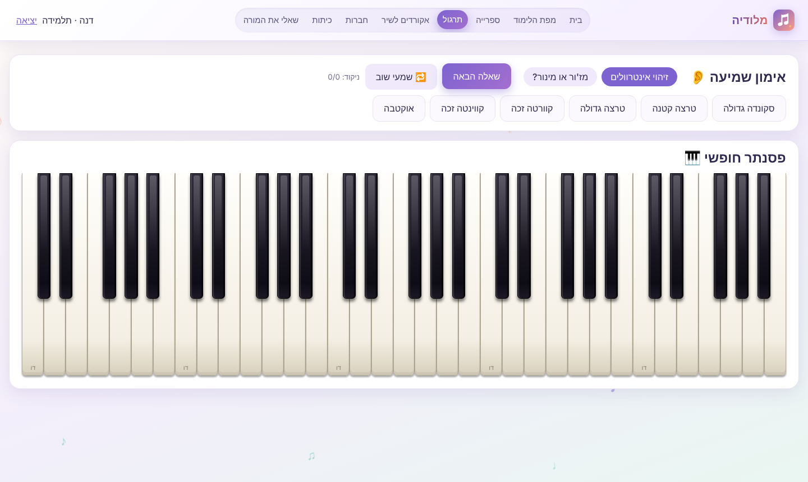

# Neima (נעימה) — AI-Driven Music Theory Learning Platform

Neima ("נעימה" — a pleasant melody; the subtitle is "עולם המוזיקה", the world of music) is a full-stack learning platform for music theory (Hebrew, right-to-left UI).
Students follow a structured curriculum with interactive piano examples and graded quizzes, ask an **AI music teacher** questions by category and sub-category,
write chords over song lyrics with an automatic **harmony check**, compete with friends, and join classes run by teachers.
An admin dashboard shows every user and their prompt history.

Built as a production-minded MVP: **REST API + MongoDB (Mongoose) + React**, layered backend, validation, JWT auth, tests, CI, Docker and Swagger docs.

| Home | Lesson | Learning map |
|---|---|---|
|  |  |  |

| Chords for a song | Ask the teacher (AI) | Practice |
|---|---|---|
|  |  |  |

---

## Table of contents
1. [Features](#features)
2. [Tech stack](#tech-stack)
3. [Project structure](#project-structure)
4. [Setup and run](#setup-and-run)
5. [Environment variables](#environment-variables)
6. [AI integration](#ai-integration)
7. [API overview](#api-overview)
8. [Data model](#data-model)
9. [Tests and CI](#tests-and-ci)
10. [Task requirements checklist](#task-requirements-checklist)
11. [Design decisions and assumptions](#design-decisions-and-assumptions)
12. [Deployment](#deployment)
13. [Troubleshooting](#troubleshooting)

---

## Features

| Area | What it does |
|---|---|
| **Learning** | 11 courses → units → 83 lessons (338 questions and quizzes, about 14 hours): basics, scales and intervals, harmony, building chords by tones, advanced harmony, keys and modes, songwriting, chords for songs, rhythm and form, styles and eras, ear training. Each lesson has playable piano examples, a short graded quiz with an explanation after every answer, XP, and "continue where I stopped" |
| **Library** | Pick a root and a chord type (19) or a scale/mode (14): the keyboard shows it instantly, with all inversions, formulas and diatonic chords |
| **Piano game** | A rhythm game: notes fall down eight lanes and the player presses the matching key (computer keys A–K or touch) in time. Four traditional / public-domain tunes, three speeds, score, combo, stars and a personal best |
| **Practice** | Free three-to-five-octave piano and an ear trainer (intervals, major or minor) |
| **AI teacher** (task requirement) | Choose a category and sub-category, write a question, get a teacher-style answer. Prompt and response are stored per user as learning history |
| **Chords for a song** | Paste your own lyrics, or let the AI write *original* lyrics from a theme. Click a word to put a chord above it (it plays immediately), set each chord's length in beats, and get a live check whether the chord fits the key. Full check gives roman numerals, cadences, known progressions and a score. Save, view with chords above the words, copy the chord sheet |
| **Social** | Add friends by e-mail, XP leaderboard, shareable lesson links, invitation by e-mail (opens the student's mail program) |
| **Classes** | Teachers create classes (join code) and see every student's progress and activity |
| **Admin** (task requirement) | All users with pagination, search and role filter, role management, each user's prompt history, system totals |
| **Extras** | Brand and logo, realistic landing piano (mouse or computer keys), optional ambient music generated with Web Audio (no audio files), confetti on a passed quiz, responsive full-width layouts |

## Tech stack
- **Backend:** Node.js 18+, Express, MongoDB Atlas + **Mongoose ODM**, JWT, bcrypt, Zod, Helmet, rate limiting, Swagger UI, Jest + Supertest
- **Frontend:** React 18 + Vite, Web Audio API
- **AI:** Google Gemini (preferred) or OpenAI behind a single interface, with an automatic offline demo fallback
- **DevOps:** Docker Compose (database only, or the full stack), GitHub Actions CI, Render blueprint

## Project structure
```
.
├── docker-compose.yml          # db only, or full stack (db + api + web)
├── render.yaml                 # one-file API deployment on Render
├── .github/workflows/ci.yml    # CI: backend tests + frontend production build
├── docs/screenshots/
├── backend/
│   ├── .env.example, Dockerfile
│   ├── scripts/check-ai.js     # npm run ai:check — sends one real test question
│   ├── src/
│   │   ├── server.js           # bootstrap: connect DB → seed → listen
│   │   ├── app.js              # Express app without DB (testable)
│   │   ├── config/             # env config, DB connection, OpenAPI spec
│   │   ├── routes/             # URL → middleware → controller (one file per feature)
│   │   ├── controllers/        # HTTP in/out only, no business rules
│   │   ├── services/           # business logic: AI, harmony checker, lyrics, stats
│   │   ├── models/             # Mongoose schemas
│   │   ├── validators/         # Zod request schemas
│   │   ├── middleware/         # auth (JWT + roles), validation, rate limits, errors
│   │   ├── utils/              # constants, music tables, helpers
│   │   ├── data/curriculum/    # course content as JSON
│   │   └── seed/               # idempotent seeding (curriculum + admin)
│   └── tests/
└── frontend/
    └── src/
        ├── App.jsx, main.jsx   # shell, navigation, state router
        ├── pages/              # one file per screen
        ├── components/         # Piano, HeroPiano, Markdown, Confetti, composer/*
        ├── music/              # theory tables, Web Audio synth and ambient music
        ├── hooks/, api/, utils/, styles/
```

Layering rule: **routes** only wire URLs to middleware and controllers; **controllers** translate HTTP to service calls; **services** hold all business rules and never touch `req`/`res`; **models** define the data and constraints.

## Setup and run

**Prerequisites:** Node.js 18+ and a MongoDB Atlas free cluster (or Docker for a local MongoDB).

1. **Database.** Atlas: create a cluster → *Database Access* (user and password) → *Network Access* (add your IP) → *Connect → Drivers* and copy the URI.
   Local alternative: `docker compose up -d mongo` and use `mongodb://localhost:27017/music_academy`.
2. **Backend**
   ```bash
   cd backend
   cp .env.example .env      # Windows PowerShell: Copy-Item .env.example .env
   # edit .env: MONGODB_URI, JWT_SECRET, and optionally GEMINI_API_KEY
   npm install
   npm run dev               # http://localhost:4000   (Swagger: http://localhost:4000/api/docs)
   ```
   On first start the curriculum and an admin account (`ADMIN_PHONE` / `ADMIN_PASSWORD`) are created automatically.
3. **Frontend** (second terminal)
   ```bash
   cd frontend
   npm install
   npm run dev               # http://localhost:5173  (proxies /api to the backend)
   ```
4. **Tests:** `cd backend && npm test`

**Everything with Docker (no Node needed):**
```bash
docker compose up --build     # app: http://localhost:8080 · API docs: http://localhost:8080/api/docs
```
Optional variables (`JWT_SECRET`, `GEMINI_API_KEY`, `OPENAI_API_KEY`, `ADMIN_PHONE`, `ADMIN_PASSWORD`) are read from your shell or a root `.env` file.

**First steps in the app:** register (name, phone, e-mail, password) → *מפת הלימוד* → open a lesson → take the quiz → try *שאלי את המורה* and *אקורדים לשיר*.
Sign in with the admin phone/password and open *ניהול* for the admin dashboard. To make a teacher: *ניהול* → change the user's role.

## Environment variables
Copy `backend/.env.example` to `backend/.env`. **Never commit `.env`** (it is in `.gitignore`).

| Variable | Purpose |
|---|---|
| `PORT` | API port, default `4000` |
| `MONGODB_URI` | Atlas or local MongoDB connection string |
| `JWT_SECRET` | Signing key for JWTs (use a long random value) |
| `GEMINI_API_KEY` | Optional. Google Gemini key (preferred provider) |
| `GEMINI_API_KEYS` | Optional. Several Gemini keys, comma separated. A key that is out of quota (429) or rejected (401/403) is skipped and the next one is used; requests are spread across the keys |
| `GEMINI_MODEL` | Default `gemini-2.5-flash` (other models are tried automatically if it is busy) |
| `OPENAI_API_KEY` | Optional alternative provider (keys starting with `sk-`) |
| `OPENAI_MODEL` | Default `gpt-4o-mini` |
| `ADMIN_PHONE`, `ADMIN_PASSWORD` | Admin account created on first start. Change before deploying |

## AI integration
All AI features go through one function, `askModel()` in `backend/src/services/ai.service.js`:
- **Providers:** Gemini (REST `generateContent`) or OpenAI chat completions, chosen by which key exists. A key that does not start with `sk-` is treated as a Gemini key.
- **Resilience:** if a Gemini model is busy (HTTP 503/429) or unavailable (404), the service tries other models and retries a few times with a short wait. An address blocked by a content filter (e.g. NetFree, HTTP 418) is skipped.
- **Several keys:** `GEMINI_API_KEYS=key1,key2,key3` (keys from separate Google projects). Requests rotate across the keys and a failing key is skipped; `/api/ai/status` reports how many keys are configured.
- **Fallback:** if no key exists or the AI is down, the app answers with a deterministic demo engine, so every screen still works.
- **Teacher prompt:** the system prompt asks for a short, accurate, structured lesson in simple text; answers are rendered with a small safe Markdown renderer (no HTML is injected).
- **Lyrics:** the AI writes *original* lyrics only. Lyrics of existing songs are never fetched (copyright); students paste their own.
- **Harmony feedback is not generated by an LLM.** `harmony.service.js` is a rule-based theory engine (key membership, roman numerals, cadences, known progressions), so the chord guidance is always correct and testable.

**Checking the connection**
- Start-up line shows `AI: gemini` (or `demo mode`).
- A successful call logs `AI answered (<model>, <host>)`; a failure logs `AI request failed: ...`.
- `npm run ai:check` in `backend`, or open `http://localhost:4000/api/ai/status?test=1` to send one real test question and see the exact reason if it fails (keys are never shown).

## API overview
Interactive docs at **`/api/docs`** (Swagger UI). Protected routes expect `Authorization: Bearer <JWT>`; all errors are JSON `{ error, details? }`.

| Group | Endpoints |
|---|---|
| Auth | `POST /auth/register`, `POST /auth/login` |
| Catalog | `GET /categories`, `GET /courses`, `GET /lessons/:id`, `POST /lessons/:id/check`, `POST /lessons/:id/quiz` |
| AI teacher | `POST /prompts` (category, sub-category, prompt → stored response), `GET /prompts/me` |
| Compositions | `GET/POST/PUT/DELETE /compositions`, `POST /compositions/lyrics`, `POST /compositions/analyze` |
| Friends | `GET /friends`, `POST /friends` (by e-mail), `POST /friends/:id/accept`, `DELETE /friends/:id` |
| Classes | `GET/POST /classes`, `POST /classes/join`, `GET /classes/:id/progress` |
| Admin | `GET /admin/overview`, `GET /admin/users` (page, limit, search, role), `PATCH /admin/users/:id/role`, `GET /admin/users/:id/prompts` |
| AI status | `GET /ai/status` |

## Data model
MongoDB collections (Mongoose): `users`, `categories`, `sub_categories`, `prompts`, plus `lessons`, `progress`, `friendships`, `classrooms`, `songs`, `compositions`.

- `users` — name, phone (unique), email (unique, sparse), passwordHash, role (`student` | `teacher` | `admin`), lastLessonId
- `categories` 1 → N `sub_categories` (categoryId)
- `prompts` — userId, categoryId, subCategoryId, prompt, response, createdAt (**one user has many prompts**)

## Tests and CI
- `cd backend && npm run smoke` (with the API running) is a one-minute end-to-end check: register, login, courses, quiz, AI teacher, harmony check, songs, friends and role guards, each printed as ✓ / ✗. A manual checklist is in `docs/CHECKLIST.md` (Hebrew).
- `cd backend && npm test` runs Jest + Supertest: the harmony checker, services, validators, curriculum integrity (every lesson, quiz and playable example is valid) and API guards (health, 404, validation, JWT required, Swagger served).
- `.github/workflows/ci.yml` runs the backend tests and the frontend production build on every push and pull request.

## Task requirements checklist
| Requirement | Status |
|---|---|
| REST API with structured routes; layers: routes / controllers / models / services | ✅ |
| Database + ORM (MongoDB + Mongoose), relationships and constraints (refs, unique indexes, enums, required) | ✅ |
| Models `users`, `categories`, `sub_categories`, `prompts` (user, category, sub-category, prompt, response, created at); a user has many prompts | ✅ (camelCase field names, e.g. `userId` ≙ `user_id`) |
| AI integration behind a clear interface (real provider, or mock) | ✅ Gemini / OpenAI + demo fallback |
| Dashboard: register, select category and sub-category, submit a prompt, view the response, view the history | ✅ |
| Admin dashboard: all users and their prompt history | ✅ |
| README: setup, technologies, assumptions, how to run, `.env` example | ✅ |
| Docker Compose for the database | ✅ db only, or full stack |
| dotenv / configuration management | ✅ `config/` |
| Input validation and API error handling | ✅ Zod + one central error handler |
| Clean, documented, modular code | ✅ |
| Public GitHub repository with a clear commit history | ✅ |
| **Bonus** JWT authentication | ✅ |
| **Bonus** pagination and filtering in admin | ✅ page / limit / search / role |
| **Bonus** unit / integration tests | ✅ Jest + Supertest |
| **Bonus** Swagger / OpenAPI | ✅ |
| **Bonus** CI pipeline | ✅ GitHub Actions |
| **Bonus** deployment configuration | ✅ `render.yaml`, Dockerfiles |
| Bonus TypeScript | ❌ not used |

## Design decisions and assumptions
- **Layers over shortcuts.** Routes wire URLs, controllers handle HTTP, services hold the rules, so the rules can be tested without a database or a server. Everything that can go wrong at the edge (validation, auth, roles, rate limits, malformed ids) is handled by middleware and one error handler.
- **One AI interface, with a fallback.** Providers can be swapped without touching features, and the project runs fully without a key.
- **Deterministic harmony engine.** Chord feedback must be correct, so it is rule-based, not LLM-generated. It supports 19 chord types and major or natural-minor keys; the harmonic-minor dominant and common borrowed chords count as "colour".
- **Phone + password login.** A password was added because JWT authentication is a bonus requirement. An e-mail is collected at registration and used to find friends.
- **Invitations open the student's own mail program** (`mailto:`) with a ready message instead of sending mail from the server, so no SMTP server or credentials are needed. A server-side mailer (for example nodemailer) can be added behind the same button.
- **camelCase in the database** (`userId`, `categoryId`, `subCategoryId`, `createdAt`) instead of snake_case.
- **Quiz feedback** is revealed per question for instant teaching; XP is awarded once per lesson, on the first pass (60% to pass).
- **Copyright.** The AI writes original lyrics only; lyrics of existing songs are pasted by the student.
- **Existing accounts** created before e-mail was added have no e-mail and can not be found in the friends search; they can simply register again.

## Deployment
Backend → Render (`render.yaml` blueprint included; set `MONGODB_URI`, `JWT_SECRET`, `GEMINI_API_KEY` in the dashboard) or Railway (start command `npm start`).
Frontend → Vercel or Netlify with `VITE_API_URL=https://<api-host>/api`.
Remember to allow the host's IP (or `0.0.0.0/0` for a demo) in Atlas *Network Access*.

## Troubleshooting
| Symptom | Fix |
|---|---|
| `EADDRINUSE ... :4000` | Another backend is still running. Close the old terminal, or `netstat -ano \| findstr :4000` then `taskkill /PID <pid> /F` |
| `AI: demo mode` at start-up | No key found. Put `GEMINI_API_KEY=...` (no quotes, no spaces) in `backend/.env` and restart |
| Gemini `503 ... high demand` | Temporary load at Google. The service retries other models; try again in a minute |
| Gemini `418 ... NetFree` | The content filter blocks an address; the service skips it. If all are blocked, ask the filter provider to open `generativelanguage.googleapis.com` |
| Can not connect to MongoDB | Check the URI, the database user and the Atlas *Network Access* list |
| `React is not defined` after copying files over an old project | Unzip into a clean folder, keep only `backend/.env`, run `npm install` in both folders |
